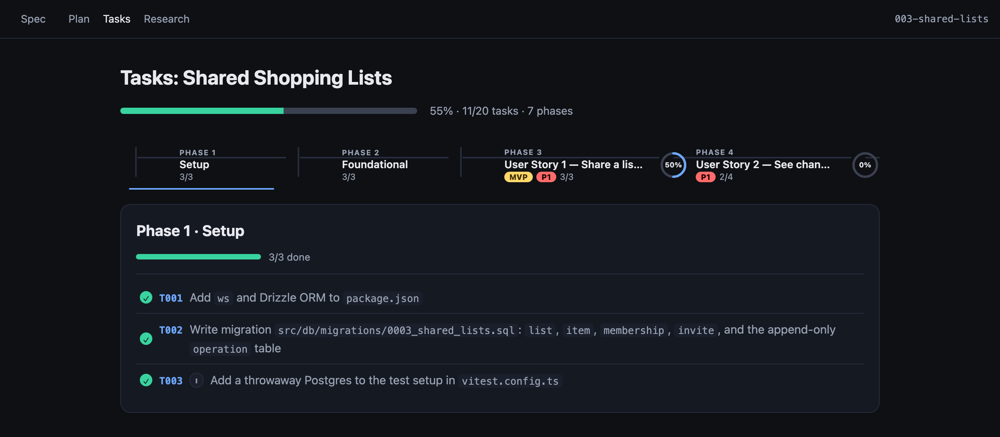
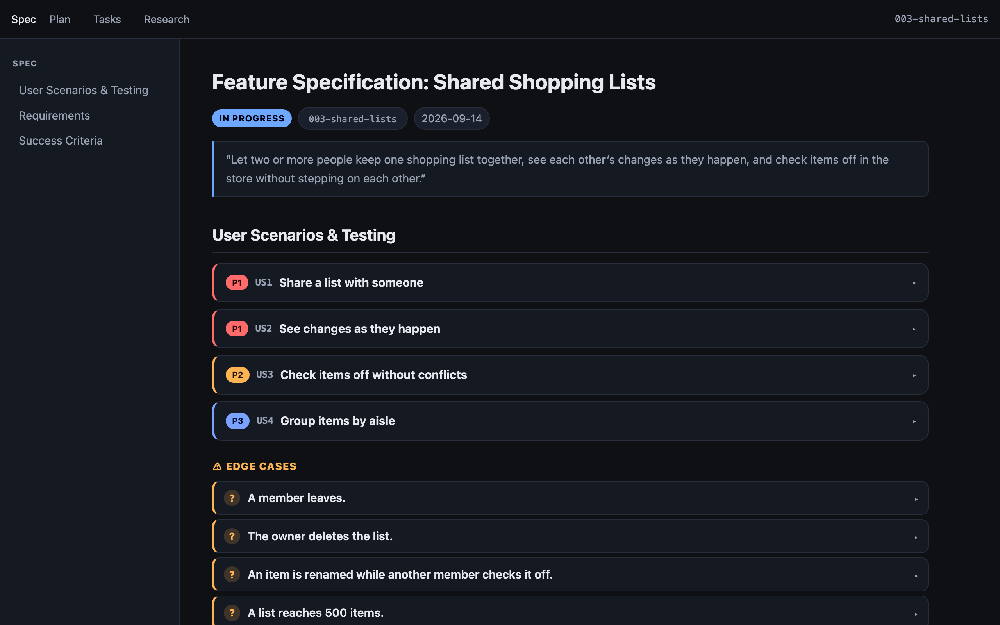

# @snackbyte/spec-render

Turn the Markdown files that [Spec Kit](https://github.com/github/spec-kit) writes —
`spec.md`, `plan.md`, `tasks.md` and the rest — into interactive HTML pages you can read
in a browser: a roadmap for your tasks, a dashboard for your spec, a navigable plan.

Your Markdown stays the source of truth. Each `<name>.md` gets a sibling `<name>.html`;
nothing else in your project changes.



## Quick start

You need **Node.js 24 or newer** (`node --version`). From the root of a project that
uses Spec Kit (the folder that holds `specs/`):

```sh
npx @snackbyte/spec-render
```

That renders every `.md` under `./specs` and prints each page it wrote:

```text
  specs/001-login/plan.md -> specs/001-login/plan.html
  specs/001-login/spec.md -> specs/001-login/spec.html
  specs/001-login/tasks.md -> specs/001-login/tasks.html

Rendered 3 file(s) to HTML.
```

Open any of those `.html` files in your browser. Keep them current while you edit:

```sh
npx @snackbyte/spec-render --watch
```

No Spec Kit project to hand? The repository has a sample feature to try it on:
[`examples/specs/003-shared-lists`](https://github.com/jeff-fichtner/snackbyte-spec-render/tree/main/examples/specs/003-shared-lists).

## What you get

- **`tasks.md` → a roadmap timeline**: overall progress, a chip per phase with a
  progress ring, and the selected phase's tasks.
- **`spec.md` → a dashboard**: user stories as priority-badged cards, filterable
  functional requirements and success criteria.
- **`plan.md` → a navigable plan**: the Technical Context as a grid, Constitution Check
  principles as cards.
- **Everything else** (`research.md`, `data-model.md`, `quickstart.md`, any Markdown) →
  a clean reading view.

Every page has a sticky table of contents that follows your scroll, collapsible
sections, linkable headings, syntax-highlighted code, and a bar linking the other
artifacts of the same feature.



The pages are self-contained: styles and scripts are inline, so a page opens from disk
with no server. The one exception is diagrams: a page with a ` ```mermaid ` block loads
the [Mermaid](https://mermaid.js.org) renderer from the jsDelivr CDN when it opens, so
those diagrams need a network connection. Pages without one load nothing from the
network.

## Command line

```text
Usage: spec-render [options] [path]

  path            a .md file, or a directory to render recursively
                  (default: ./specs, resolved against the current directory)

Options:
  -w, --watch     render, then re-render each file when it is saved
  -c, --clean     remove the generated .html next to each .md instead
  -h, --help      show this help
  -v, --version   show the installed version
```

```sh
spec-render                      # render every .md under ./specs
spec-render specs/001-login      # render one feature
spec-render specs/001-login/spec.md
spec-render --watch              # keep the views current while you edit
spec-render --clean              # delete the generated views
```

Paths are resolved against the directory you run it from. A directory is searched
recursively, skipping `node_modules` and hidden folders (`.git`, `.specify`, …). It exits `0` on success, `1`
when a path doesn't exist or a file fails to render (the other files still render), and
`2` when the command line is wrong (an unknown option, more than one path).

### Using it in a project

Install it as a dev dependency so everyone on the project gets the same version:

```sh
npm install --save-dev @snackbyte/spec-render
```

```json
{
  "scripts": {
    "spec:html": "spec-render",
    "spec:html:watch": "spec-render --watch"
  }
}
```

The `.html` files are generated, so keep them out of git — add this to `.gitignore`:

```text
specs/**/*.html
```

## Library

The same renderers are importable. Every render function is pure (Markdown string in,
HTML string out); only `renderFile` touches the filesystem.

```js
import { renderArtifact, renderMarkdown, renderFile } from '@snackbyte/spec-render';
import { readFile } from 'node:fs/promises';

// Pick the view from the artifact's file name (tasks.md, spec.md, plan.md, or generic):
const src = await readFile('specs/007-widget/tasks.md', 'utf8');
const html = renderArtifact(src, { name: 'tasks.md', title: 'Widget Tasks' });

// Or use the generic reading view for any Markdown:
const page = renderMarkdown('# Notes\n\nAnything.', { title: 'Notes' });

// Or read a .md and write its sibling .html in one call:
await renderFile('specs/007-widget/plan.md', { specsRoot: 'specs' });
```

| Export                                                           | Kind                       | Description                                                                                                       |
| ---------------------------------------------------------------- | -------------------------- | ----------------------------------------------------------------------------------------------------------------- |
| `renderArtifact(src, opts)`                                      | `(string) => string`       | Render Markdown, dispatching to the tasks/spec/plan view by `opts.name` (falls back to the generic view).         |
| `renderMarkdown(src, opts)`                                      | `(string) => string`       | Render Markdown to the generic reading view (TOC, badges, highlighting, lazy Mermaid).                            |
| `renderFile(mdPath, opts)`                                       | `async (string) => string` | Read a `.md`, render it, write the sibling `.html`, return its path. Discovers sibling artifacts for the nav bar. |
| `renderTasksTimeline` / `renderSpecDashboard` / `renderPlanView` | `(string) => string`       | The three purpose-built views directly.                                                                           |
| `looksLikeTasks` / `looksLikeSpec` / `looksLikePlan`             | `(string) => boolean`      | Content predicates the dispatch uses.                                                                             |
| `navBar(opts)` / `NAV_STYLES` / `NAV_KEYS`                       | markup / CSS / keys        | The shared cross-artifact nav bar building blocks.                                                                |

`opts` for the render functions: `{ title?: string, nav?: object }`. `renderArtifact`
also takes `{ name?: string }` (the artifact file name used to pick a view).
`renderFile` takes `{ specsRoot?: string }` (the folder the feature label in the nav bar
is made relative to).

The package is ESM-only (`import`, not `require`) and ships no TypeScript type
declarations.

## Troubleshooting

- **`No specs/ folder in …`** — `spec-render` with no path looks for `./specs` in the
  directory you ran it from. Run it from your project root, or pass the path:
  `spec-render path/to/specs`.
- **`npm warn EBADENGINE Unsupported engine`** — your Node.js is older than 24.
  Upgrade Node; older versions are not tested.
- **A diagram shows as plain text** — Mermaid loads from the jsDelivr CDN, so the page
  needs a network connection when it opens.

Tested on macOS and Linux. Bugs and ideas:
[GitHub issues](https://github.com/jeff-fichtner/snackbyte-spec-render/issues).

## Releases

Every version is published from GitHub Actions with npm
[provenance](https://docs.npmjs.com/generating-provenance-statements): its npm page
links the exact commit and workflow that built it. Versions follow
[SemVer](https://semver.org); while the version is `0.x`, a minor release may change
the library API.

## Contributing

`npm ci`, then `npm run check:all` (format, lint, typecheck, publish-contract check,
tests) is the gate every change passes. The source ships as-is, with no build step.
[`RELEASING.md`](https://github.com/jeff-fichtner/snackbyte-spec-render/blob/main/RELEASING.md)
is the release runbook;
[`DECISIONS.md`](https://github.com/jeff-fichtner/snackbyte-spec-render/blob/main/DECISIONS.md)
records how the package was put together.

## License

[MIT](https://github.com/jeff-fichtner/snackbyte-spec-render/blob/main/LICENSE) © Jeff Fichtner
